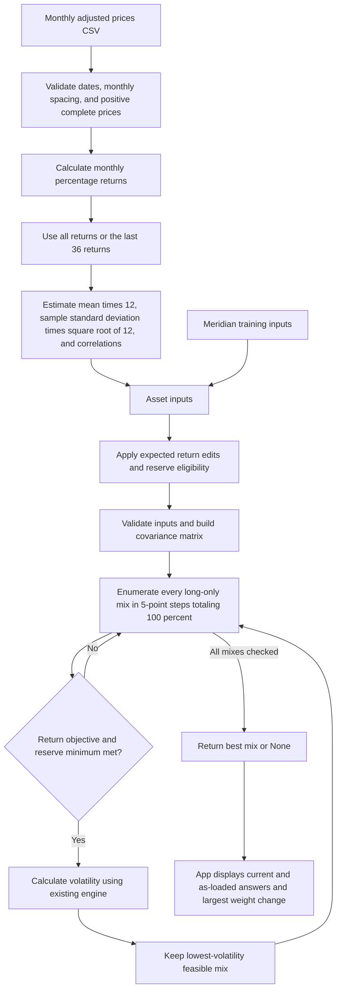

# Lab 15 — Portfolio Stability Decision

Built with AI help; a learning demonstration, not investment advice.

## Question
Which mix carries the least risk while meeting the mandate — and does the
answer survive a one-point change in one estimate?

## Run
```powershell
.\.venv\Scripts\python.exe portfolio.py
.\.venv\Scripts\python.exe -m streamlit run app.py
```

Files: [engine](portfolio.py), [app](app.py),
[dependencies](requirements-lab15.txt), [verification](validate_lab15.py).
The original Lab 14 console output is preserved. The search minimizes volatility
among long-only portfolios totaling 100%, in 5-percentage-point steps. It tests
the return objective and reserve minimum, not every provision of a full IPS.
A 3% reserve minimum effectively requires at least 5% on this grid.

## Meridian verification
Weights below are Bills / 10-year / IG / equity, in percent.

| Run | Weights | Return | Volatility | Reserve |
|---|---|---|---|---|
| As loaded | 0 / 20 / 25 / 55 | 6.51% | 9.44% | 20.00% |
| Equity estimate 8% → 7% | 0 / 10 / 10 / 80 | 6.53% | 12.94% | 10.00% |
| IG–equity correlation 0.25 → 0.50 | 0 / 40 / 0 / 60 | 6.52% | 9.73% | 40.00% |

Objective: 6.50%. Reserve minimum: 3%; bills and the 10-year note qualify.
The first stress moves equity by **25 percentage points**. A smaller equity
return estimate forces more equity into the least-risk feasible mix because the
return objective stays fixed. Feasibility survives, but the allocation is sensitive.
The correlation probe must be restored to 0.25 after verification.
See [executed verification output](Lab15-validation.txt); these are AI-assisted
technical checks, not a claimed partner exercise.

## Engine flowchart


Last 36 means 36 monthly returns, requiring 37 price rows. Annual expected
returns use the historical arithmetic mean, not CAGR or a forecast. Both answers
use the same selected objective and reserve rule; the as-loaded answer retains
original estimates on all months. The app holds no separate portfolio math.

## Intel-related Project 2 example — proposed classroom mandate
On October 22, the student identified Intel and asked AI to find the inputs.
Intel was the Project 1 company. Since this lab requires 3–6 funds, this example
uses a semiconductor fund as its Intel-related exposure, alongside broad stocks,
bonds, and Treasury bills. It does not directly hold INTC, require a positive
semiconductor weight, or claim to represent Intel's treasury investment policy.

**Proposed mandate, specified before running the search:** a hypothetical
long-term investor researching Intel's industry seeks at least **6.50% nominal
annual expected return**, with **at least 5% in SGOV** as a Treasury-bill reserve.
The portfolio is long-only, fully invested, and searched in 5-point steps.
These objective/reserve choices are AI-proposed classroom assumptions, not
facts found in filings or a previously written student mandate. The 5% reserve
equals one grid step. The objective was not reduced to force feasibility.
Taxes, investor trading costs and advisory fees are not modeled.

| Ticker | Role and issuer source | Monthly adjusted-price source | Download date |
|---|---|---|---|
| SOXX | [iShares Semiconductor ETF](https://www.ishares.com/us/products/239705/ishares-phlx-semiconductor-etf); sector connection to Intel, not a substitute for owning Intel | [Yahoo Finance SOXX history](https://finance.yahoo.com/quote/SOXX/history/) | 2026-10-22 UTC |
| VTI | [Vanguard U.S. total stock market ETF](https://investor.vanguard.com/investment-products/etfs/profile/vti); broad equity exposure | [Yahoo Finance VTI history](https://finance.yahoo.com/quote/VTI/history/) | 2026-10-22 UTC |
| BND | [Vanguard Total Bond Market ETF](https://investor.vanguard.com/investment-products/etfs/profile/bnd); broad bond exposure | [Yahoo Finance BND history](https://finance.yahoo.com/quote/BND/history/) | 2026-10-22 UTC |
| SGOV | [iShares 0–3 Month Treasury Bond ETF](https://www.ishares.com/us/products/314116/ishares-0-3-month-treasury-bond-etf); sole reserve-eligible fund under the proposed rule | [Yahoo Finance SGOV history](https://finance.yahoo.com/quote/SGOV/history/) | 2026-10-22 UTC |

[prices.csv](prices.csv) contains 61 calendar-month-end rows, September 2021
through September 2026. Each value is the last trading day's Yahoo **Adj Close**
for that month, using `indicators.adjclose[0].adjclose`, not raw Close. The date
labels are calendar month ends, even when the last trading day is earlier.
This yields 60 monthly returns, October 2021–September 2026. The recent sample
is October 2023–September 2026. The unfinished October 2026 month is excluded.
No missing prices are filled. Dates, currency, symbols, positive prices and
monthly coverage were checked. Raw responses and exact endpoint/download
timestamps are retained in [Lab15-data/sources.json](Lab15-data/sources.json).
Refresh script: [fetch_lab15_prices.py](fetch_lab15_prices.py).

Historical arithmetic annualized return estimates, **not forecasts**:

| Fund | All-month return estimate | Last-36 return estimate | All-month volatility | Last-36 volatility |
|---|---|---|---|---|
| SOXX | 34.62% | 50.54% | 37.76% | 37.89% |
| VTI | 13.13% | 21.11% | 15.94% | 12.86% |
| BND | -0.42% | 4.10% | 6.45% | 5.50% |
| SGOV | 3.72% | 4.44% | 0.50% | 0.21% |

| Run | SOXX / VTI / BND / SGOV (%) | Return | Volatility | Reserve |
|---|---|---|---|---|
| All 60 returns | 10 / 0 / 0 / 90 | 6.81% | 3.84% | 90.00% |
| Last 36 returns | 5 / 0 / 0 / 95 | 6.74% | 1.87% | 95.00% |
| All months, SOXX estimate reduced by 1 point | 10 / 0 / 0 / 90 | 6.71% | 3.84% | 90.00% |

Largest all-months versus last-36 weight change: **5 percentage points**.
Largest change under the separate one-point SOXX stress: **0 points**. The stress
uses the unrounded estimate, 34.619394% → 33.619394%; only the display is rounded.
The same objective and reserve rule apply throughout. Machine-readable results:
[Lab15-data/results.json](Lab15-data/results.json).

In the app, select **Load Intel-related fund example**. The proposed 5% reserve
minimum and SGOV eligibility load automatically. Toggle **Use last 36 months**
to compare against all months. A custom upload overrides the example data and
requires checking its eligible funds yourself.

## Draft call and learning explanation — AI-assisted, for student review
**Pilot** the all-months 10% SOXX / 90% SGOV mix as a classroom starting point.
The one-point SOXX reduction leaves weights unchanged, but shortening the window
halves the semiconductor allocation from 10% to 5%, and the historical SOXX mean
is not a defensible forward forecast by itself. Adopt only after independently
justified forward estimates still meet the unchanged mandate and the allocation
stays within a proposed 5-point tolerance across both lookback and one-point
tests. The tolerance is a proposed decision condition, not an observed client rule.

Estimation risk is the risk that estimated returns, volatilities and correlations
differ from the future. The search treats estimates as exact; small changes can
make a previously feasible portfolio fail the return threshold, pushing the
answer to a different grid allocation. Here the higher recent SOXX and SGOV
return estimates let just 5% SOXX clear the objective. The one-point SOXX stress
does not cross a grid boundary, so zero weight change is limited evidence of
robustness. Neither test guarantees future returns or losses.

The one-point stress above was run by AI. It is **not the partner attack**.

## Simulated partner attack
Partner: **Sam Stewart** (identified by the student). The student reports that
the professor permits a made-up estimate change for this exercise. This scenario
is simulated; it does not claim that Sam selected or entered the change.

Use all 60 monthly returns and restore all original estimates first. Question:
what if future Treasury-bill returns are one percentage point lower than the
historical estimate? Reduce SGOV from **3.715069% to 2.715069%** (the app displays
**3.72% to 2.72%**). Keep the 6.50% objective, 5% SGOV reserve minimum, all other
expected returns, volatilities and correlations unchanged.

| Run | SOXX / VTI / BND / SGOV (%) | Return | Volatility | Reserve |
|---|---|---|---|---|
| Original all-month inputs | 10 / 0 / 0 / 90 | 6.81% | 3.84% | 90.00% |
| SGOV return estimate minus 1 point | 10 / 10 / 0 / 80 | 6.95% | 5.14% | 80.00% |

Largest weight change: **10 percentage points**, as SGOV falls from 90% to 80%
and VTI rises from 0% to 10%. Results use the unrounded estimates in the engine.

Two-sentence response: Reducing SGOV's expected return by one percentage point
moves 10 percentage points from Treasury bills into broad U.S. equities and
raises estimated portfolio volatility from 3.84% to 5.14% while still meeting
the unchanged mandate. I would pilot rather than adopt the original mix because
this stress exceeds the proposed 5-point stability tolerance, and would reconsider
adoption only after justified forward estimates pass that same tolerance across
both lookback and one-point tests.

This additional test makes the draft call above more cautious: the SOXX-only
stress was stable, but stability does not extend to the reserve-return estimate.

## Engine drawing and code explanation
The student reports that the professor permits prepared substitutes for the
paper drawing and partner explanation. The diagram and explanation below supply
those materials. They do not document a physical drawing or an actual exchange.

### Drawing layout
The Mermaid diagram above is the detailed engine drawing. This compact layout
shows the same main steps:

```text
[prices.csv: dated monthly adjusted prices]
                    |
                    v
[Check dates, complete months, and positive prices]
                    |
                    v
[Monthly return = this price / previous price - 1]
                    |
                    v
[All 60 returns OR last 36 returns]
                    |
                    v
[Annual mean, annual volatility, correlations]
                    |
                    v
[Return edits + objective + reserve rule]
                    |
                    v
[Covariance matrix]
                    |
                    v
[Try every 5-point mix totaling 100%] <--------+
                    |                         |
                    v                         |
[Meets return AND reserve minimum?] -- No -----+
                    | Yes                     |
                    v                         |
[Calculate volatility; keep best so far] ------+
                    |
              After all mixes
                    v
[Lowest-risk feasible mix, or no feasible mix]
                    |
                    v
[Compare current answer with as-loaded answer]
```

### Mandate explanation for Sam Stewart
The universe is SOXX, VTI, BND and SGOV. SOXX connects the project to Intel's
semiconductor industry; the other funds provide broad stocks, bonds and
Treasury bills. The proposed numerical objective is at least 6.5% annual
expected return, and the reserve constraint requires at least 5% in SGOV.
The engine chooses the lowest estimated volatility among qualifying long-only
5-point allocations. These are classroom assumptions, not Intel's stated policy.

### Search function, line by line
Read `search_portfolio` in [portfolio.py](portfolio.py) alongside this table.

| Code statement | Explanation |
|---|---|
| `def search_portfolio(...)` | Accepts the assets, correlations, return objective, reserve minimum, and indices of reserve-eligible assets. Defaults are Meridian's; the personal example passes its own rule. |
| `covariance = covariance_matrix(sleeves, correlations)` | Checks the asset inputs and converts correlations and volatilities into the covariance matrix used by the existing risk calculation. |
| `n = len(sleeves)` | Counts the assets. |
| `if not 1 <= n <= 6:` and its `raise` | Rejects unsupported universe sizes instead of attempting an unexpectedly large search. |
| `eligible_indices = tuple(set(eligible_indices))` | Removes duplicate reserve indices so an asset cannot be counted twice. |
| `if any(i < 0 or i >= n ...)` and its `raise` | Rejects reserve indices that do not refer to an asset. |
| The finite-objective and reserve-range check, with its `raise` | Rejects nonfinite objectives and reserve minimums outside 0–100%. Rates are decimals inside the engine. |
| `best = None` | Starts with no feasible answer; this stays `None` if every mix fails. |
| `for dividers in combinations(range(20 + n - 1), n - 1):` | Splits twenty 5% units among the assets by trying every possible placement of the dividers. This includes zero-weight assets and visits each allocation once. |
| `edges = (-1,) + dividers + (20 + n - 1,)` | Adds boundaries before and after the divider positions so the first and last asset's units can be counted too. |
| `weights = [(edges[i + 1] - edges[i] - 1) / 20 ...]` | Counts units in each gap and divides by 20 to obtain decimal weights. All weights are nonnegative and sum to one. |
| `result_return = expected_return(weights, sleeves)` | Calls the existing engine to calculate the weighted-average expected return. |
| `reserve = reserve_weight(weights, eligible_indices)` | Adds the weights of just the reserve-eligible assets. |
| `if result_return < objective - 1e-12 or reserve < reserve_minimum - 1e-12:` | Rejects a mix if either requirement fails. The tiny tolerance prevents floating-point rounding from rejecting equality at a boundary. |
| `continue` | Skips the rejected mix and tries the next one. |
| `volatility = portfolio_volatility(weights, covariance)` | Uses the existing engine to calculate risk for a feasible mix, including covariance terms. |
| `if best is None or volatility < best["volatility"]:` | Keeps the first feasible mix, then replaces it only when a lower-volatility feasible mix appears. Exact ties retain the first one encountered. |
| `best = {...}` | Stores that mix's weights, return, volatility and reserve weight together. |
| `return best` | After the entire grid has been searched, returns the best feasible result, or `None`. |

Divider example: with four assets, `dividers = (2, 3, 4)` gives boundaries
`(-1, 2, 3, 4, 23)`. The gaps contain `2, 0, 0, 18` units, producing
`10%, 0%, 0%, 90%` in SOXX / VTI / BND / SGOV order. There are 1,771 possible
four-asset mixes on this grid. Lowest risk means lowest risk among these discrete
mixes, not proof of a continuous-allocation optimum.

### Practice question and answer for the explanation with Sam
**Question:** Why did lowering SGOV's return make the optimizer add VTI instead
of simply accepting a lower portfolio return?

**Answer:** The objective stayed at 6.5%. With the original 10% SOXX / 90% SGOV
weights, reducing SGOV's return by one point lowers portfolio expected return
from 6.8055% to 5.9055%, so the `if` test rejects it. The search then finds
10% SOXX / 10% VTI / 80% SGOV as the lowest-volatility remaining feasible mix,
with 6.9474% return and 5.1394% volatility. The 5-point grid explains why it
can overshoot the objective rather than land exactly on 6.5%.

### Reflection
The mix moved because the reserve sleeve was 90% of the original allocation:
a one-point error in its expected return changes total expected return by
0.90 points at unchanged weights. Meeting the fixed objective then requires
more equity exposure. Before adopting the allocation, I would need justified
forward return assumptions, a reserve rule suited to the actual client's cash
needs, and evidence that the mix meets the stated stability condition. The
observed 10-point shift fails the proposed 5-point tolerance, so the classroom
decision remains pilot rather than adopt.

## Partner dialogue: Peter and Sam
*Script for the assignment.*

**Peter:** My portfolio has four funds: SOXX, VTI, BND and SGOV. SOXX connects
it to Intel's semiconductor industry, VTI provides broad U.S. stocks, BND
provides bonds, and SGOV provides short-term Treasury bills. My proposed
objective is at least 6.5% annual expected return, with at least 5% in SGOV.

**Sam:** Does the portfolio actually own Intel stock directly?

**Peter:** No. It uses a semiconductor fund for the industry connection because
this lab calls for three to six funds. This is a proposed classroom portfolio,
not Intel's corporate investment policy.

**Sam:** Walk me through how your engine gets from prices to an allocation.

**Peter:** It checks the dates and prices, then divides each month's price by
the previous month's price and subtracts one. It uses either all 60 monthly
returns or the last 36. It multiplies the monthly mean by 12 and the sample
standard deviation by the square root of 12, and calculates correlations from
the same months. Those inputs feed the portfolio search.

**Sam:** How does the search try every mix?

**Peter:** It treats the portfolio as twenty units, each worth 5%. The
`combinations` loop places dividers between units to allocate them among the
funds. The `edges` line adds the outer boundaries, and the `weights` line
counts the units in each gap. That produces every nonnegative four-fund mix
totaling 100%, including mixes with zero in a fund.

**Sam:** What stops it from picking a low-risk mix that misses your objective?

**Peter:** For each mix, `expected_return` calculates its return and
`reserve_weight` adds its eligible reserves. The `if` statement checks both
requirements. If either fails, `continue` skips that mix. For qualifying mixes,
`portfolio_volatility` calculates risk using the covariance matrix. The code
updates `best` only when it finds a lower-volatility feasible mix.

**Sam:** What if nothing qualifies?

**Peter:** `best` starts as `None` and stays that way. The app reports
"no mix meets the objective." I should not lower the objective just to get
an answer.

**Sam:** What did the five-year and three-year runs show?

**Peter:** All months gave 10% SOXX and 90% SGOV, with 6.81% estimated return
and 3.84% volatility. The last 36 months gave 5% SOXX and 95% SGOV, with
6.74% return and 1.87% volatility. The largest weight change was five percentage
points. Those return estimates describe history; they are not forecasts.

**Sam:** I distrust the assumption that Treasury-bill returns will keep matching
the historical average. Let's use all months and lower SGOV's expected return
by one percentage point, from about 3.72% to 2.72%, while keeping everything
else unchanged.

**Peter:** Using the unrounded estimates, that changes the answer to 10% SOXX,
10% VTI, 0% BND and 80% SGOV. Expected return is 6.95%, volatility is 5.14%,
and the largest weight change is ten percentage points.

**Sam:** Why does a lower return estimate lead to a higher reported portfolio
return? That sounds backward.

**Peter:** At the original weights, expected return falls from about 6.81% to
5.91%, which fails the unchanged 6.5% objective. The engine therefore selects
a different mix with more equity. That new mix returns an estimated 6.95%;
the 5-point grid makes it overshoot the objective. It also carries more risk.

**Sam:** Your one-point SOXX test didn't change the weights. Does that prove
the original answer is stable?

**Peter:** No. That particular change left the original mix feasible and best
on the grid. SGOV was 90% of the original allocation, so a one-point change
in its return estimate cuts portfolio return by 0.90 points at unchanged
weights. The reserve-return assumption matters a lot in this portfolio.

**Sam:** What is your decision?

**Peter:** Pilot the original mix as a classroom starting allocation rather
than adopt it. The SGOV stress moves ten percentage points, exceeding the
proposed five-point stability tolerance. Before adopting, I would need
independently justified forward estimates, a reserve rule tied to actual cash
needs, and a mix that still meets the mandate while staying within that
tolerance across both lookback and one-point tests.

## Completion status
The drawing, code explanation, practice question and answer, simulated attack,
and reflection are prepared. Their preparation is not evidence of an actual
partner interaction or a student-adopted mandate. Review the proposed mandate
and draft decision before submitting. No completed quiz is claimed here.
Open Brightspace → Quizzes → Lab 15 during the lab; complete the checkout there.

## Checkout
Publish the completed notes, `portfolio.py`, `app.py`, and supporting data/source
records to your GitHub repository and submit their individual links. Publication
has not been performed. App testing reference:
[Streamlit AppTest documentation](https://docs.streamlit.io/develop/api-reference/app-testing/st.testing.v1.apptest).
